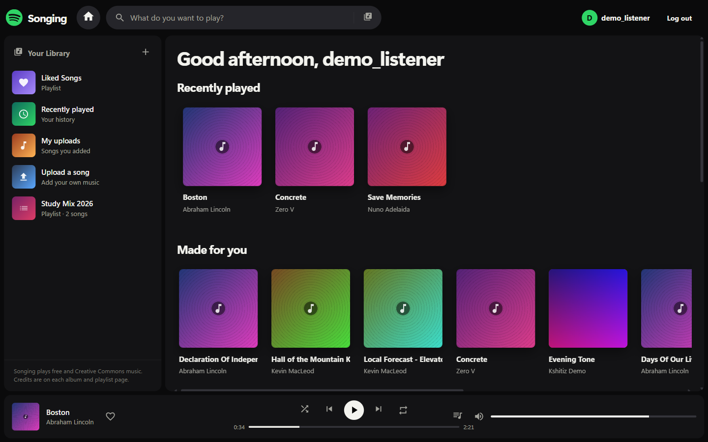
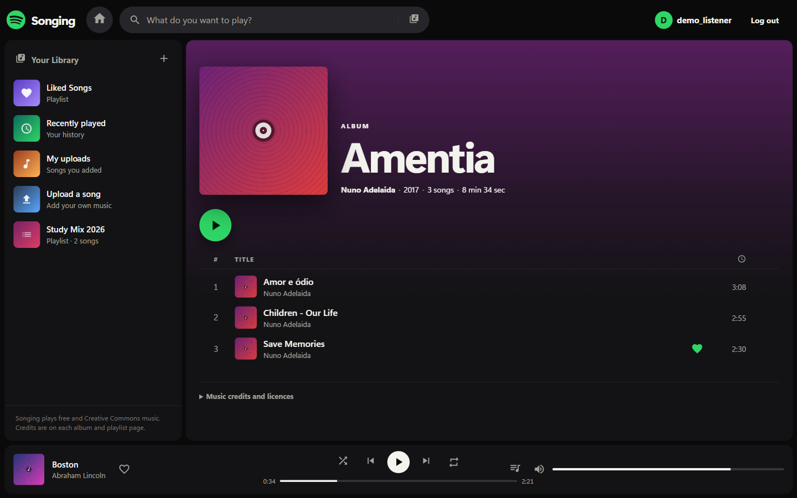
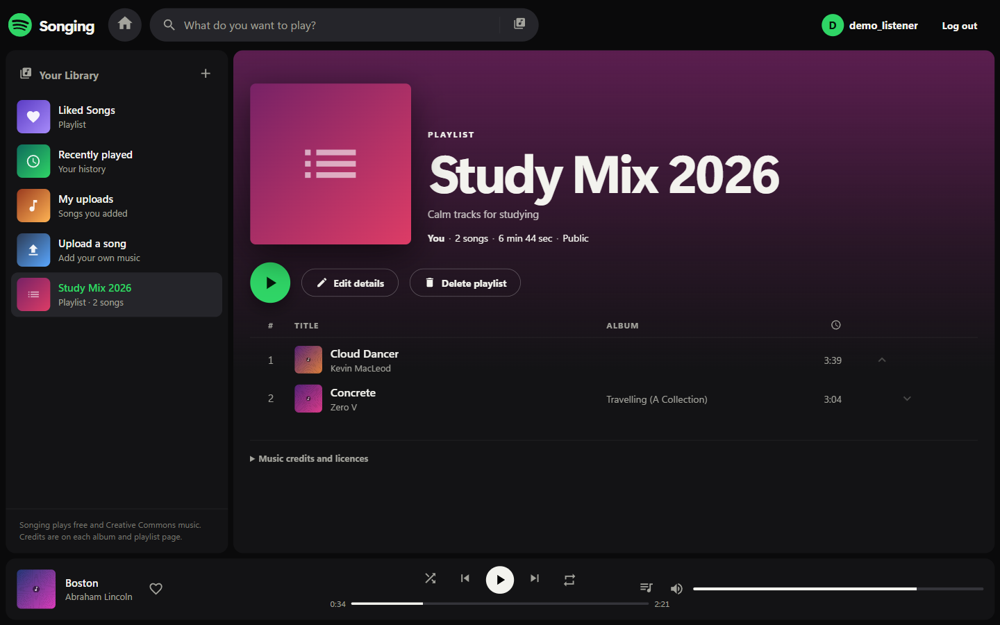
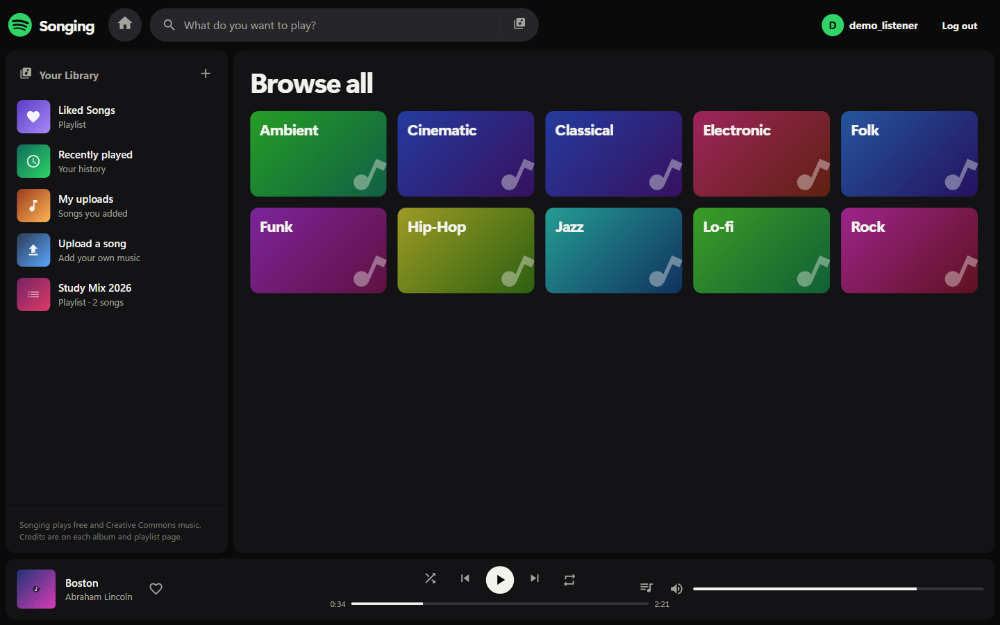
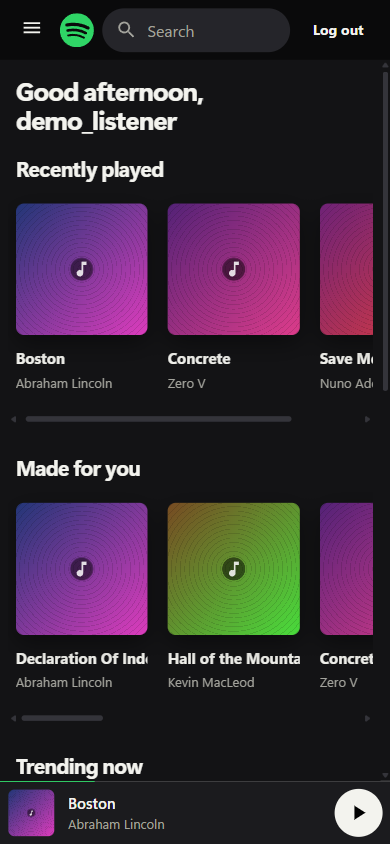
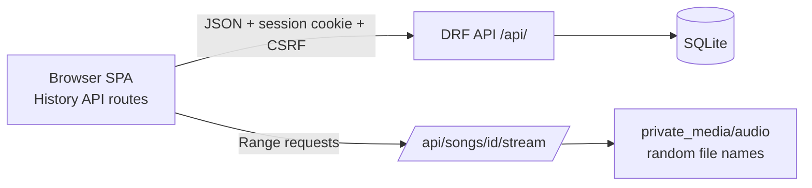

# Songing

Songing is a music streaming web app: browse and search a catalogue of Creative Commons music,
play it with a full player (seek, queue, shuffle, repeat, media keys), like songs, build
playlists, and upload your own tracks (private by default).

It is a college full-stack project with a real backend: Django + Django REST Framework serve a
JSON API and stream audio with HTTP Range support, and a single-page frontend in plain
HTML/CSS/JavaScript runs on top of it.



| Album | Playlist (owner can edit, reorder, remove) |
|---|---|
|  |  |

| Search with genre tiles | Mobile |
|---|---|
|  |  |

## Features

| Area | What works |
|---|---|
| Accounts | Sign up, log in, log out (session cookie + CSRF), rate-limited auth endpoints |
| Browse | Home (trending, new releases, artists, recently played, made for you), album, artist, genre pages |
| Search | Songs, artists, albums and playlists as you type; genre tiles |
| Player | Play/pause, next/previous, seek, volume + mute, shuffle, repeat off/all/one, queue panel, Space key, media keys (Media Session), resumes the last song after a refresh |
| Library | Liked songs, recently played, your uploads, playlists (create, rename, delete, add/remove songs, drag to reorder) |
| Upload | mp3 / m4a / ogg / wav / flac up to 25 MB, optional cover up to 5 MB, progress bar, private or public |
| Mobile | Layout adapts below 700 px |

## Tech

| Part | Choice |
|---|---|
| Backend | Python 3.13, Django 6.1, Django REST Framework 3.18 |
| Database | SQLite (a hosted database comes later) |
| Audio checks | mutagen (real audio + duration), Pillow (cover images, re-encoded to JPEG) |
| Frontend | Plain HTML, CSS and JavaScript ES modules served by Django. No build step, no npm |

The API is documented in [docs/api.md](docs/api.md).

## Run it locally

Needs Python 3.13. From the project folder:

```bash
python -m venv .venv
.venv/Scripts/python -m pip install -r requirements.txt     # macOS/Linux: .venv/bin/python
cp .env.example .env
# put a key into .env:  DJANGO_SECRET_KEY=<output of the next command>
.venv/Scripts/python -c "import secrets; print(secrets.token_urlsafe(50))"
.venv/Scripts/python manage.py migrate
.venv/Scripts/python manage.py seed_demo          # downloads and loads the demo music (about 100 MB)
.venv/Scripts/python manage.py createsuperuser    # optional, for /admin/
.venv/Scripts/python manage.py runserver 8000
```

Open http://localhost:8000. `seed_demo` is safe to run again; it updates tracks instead of
duplicating them.

Run the tests:

```bash
.venv/Scripts/python manage.py test
```

### Settings

| Variable | Meaning |
|---|---|
| `DJANGO_SECRET_KEY` | Required when `DJANGO_DEBUG` is off; the app refuses to start without it |
| `DJANGO_DEBUG` | `1` for local development. Off by default |
| `DJANGO_ALLOWED_HOSTS` | Comma-separated host names, e.g. `localhost,127.0.0.1` |

Values come from the environment; a local `.env` file (gitignored) is read too. Never commit a key.

## How it is built



- Song audio is stored outside the public media folder and is only reachable through the stream
  endpoint, which checks that the listener may hear it (a private upload is 404 for everyone
  else) and answers `Range` requests with `206 Partial Content`, so seeking works.
- A play is counted after 30 seconds of listening (or at the end of a shorter song); trending
  ranks songs by plays in the last 7 days.

## Music credits

All demo music is Creative Commons or public domain. Each track is stored with its licence,
attribution and source link, shown in the app and listed in [seed/CREDITS.md](seed/CREDITS.md).

## Notes before a public deploy

- The logo file `frontend/static/songing/img/logo.svg` is a placeholder taken from another
  brand's icon; replace that one file before deploying publicly.
- With `DJANGO_DEBUG=0`, static files and covers need a server (e.g. WhiteNoise or nginx), and
  the reverse proxy should cap request bodies at about 31 MB.
